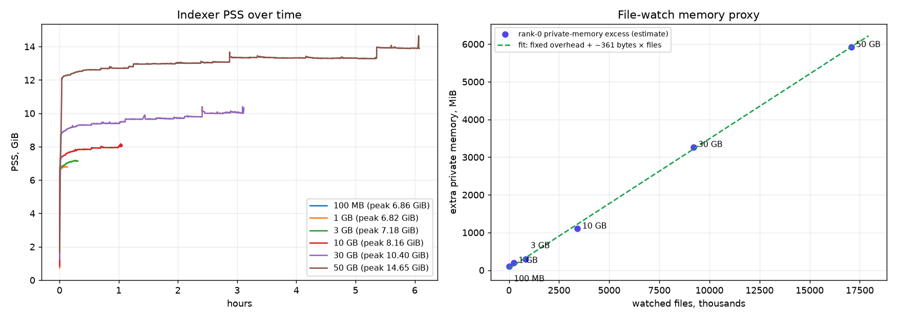
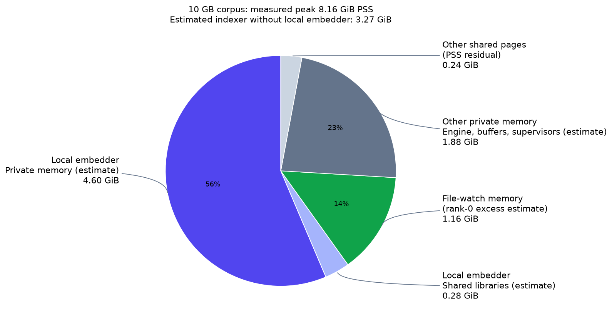

# serviette

> **Looking for llm-app templates?** All templates, cookbooks and examples
> are still available in full in the
> [Pathway repository under `examples/llm-app`](https://github.com/pathwaycom/pathway/tree/main/examples/llm-app).

<p align="center">
  <a href="https://pypi.org/project/serviette/"></a>
  <a href="https://pypi.org/project/serviette/"></a>
  <a href="https://github.com/pathwaycom/serviette/blob/main/LICENSE"></a>
  <a href="https://github.com/pathwaycom/serviette/actions/workflows/ci.yml"></a>
</p>

**A no-code, always up-to-date RAG server for any vector database — built on
the [Pathway Live Data Framework](https://github.com/pathwaycom/pathway).**

Point serviette at a folder of documents, pick a vector database and an
embedder in one YAML file, and run two commands: you get a chat and a REST API
that answer from those documents and cite their sources. From then on, any
change to the documents — an edit, a new file, a deletion — is reflected in
the answers within seconds.

serviette runs on Pathway, which needs a **free license key** — one click at
<https://pathway.com/framework/get-license> (GitHub or LinkedIn sign-in). Every
command below expects it in `PATHWAY_LICENSE_KEY`.

Try it in four commands:

```bash
pip install serviette
export PATHWAY_LICENSE_KEY=...        # free: https://pathway.com/framework/get-license
export OPENAI_API_KEY=sk-...
serviette demo --embedder openai      # → chat at http://localhost:8989
```

**Use pip 23.1 or newer** (`python -m pip install -U pip` first): older pip lacks
the resolver improvements this dependency tree needs and can take hours.

This indexes a [small bundled corpus](https://github.com/pathwaycom/serviette/tree/main/serviette/demo/corpus) (a fictional
coffee-machine company) into `./serviette-demo/docs` and opens a chat over
it. Edit or drop files into that folder while it runs — the answers
follow within seconds.

<p align="center">
  
</p>
<p align="center"><em>One command to a live RAG stack — then edit a document and watch the answer change.</em></p>

## Who is it for

**What you get.** A question-answering assistant over your organisation's
documents, with sources cited and answers that follow the documents: an edit,
a new file or a deletion is reflected within seconds, with no re-upload or
re-indexing step for anyone to run or forget.

**What it costs to run.** Two processes (an indexer and a server) and one YAML
file. Embeddings can be computed locally for free; the Pathway license is
free; the only metered component is the optional model API that writes the
answer text, billed per question rather than per document.

**Where your data goes.** Nowhere by default. With the default local
embedder, documents, their embeddings and the index stay on the machine or in
the database you choose; the only thing that leaves is the handful of passages
retrieved for a question, sent to the model API that writes the answer — and
only if you configure one. (Choosing an API embedder instead sends the
document text through that API as well.)

**How mature it is.** serviette is a thin layer over the
[Pathway Live Data Framework](https://github.com/pathwaycom/pathway) — the
open-source engine that does the watching, parsing, embedding and writing: in
development since 2022, 60 000+ GitHub stars, in production use at
organisations such as
[DB Schenker](https://pathway.com/success-stories/db-schenker),
[Intel](https://pathway.com/framework/blog/intel-summit),
[NATO](https://pathway.com/blog/jsec-pathway-ai-collaboration-steadfast-foxtrot-2024),
[La Poste](https://pathway.com/success-stories/la-poste),
[Transdev](https://pathway.com/success-stories/transdev) and
[CMA CGM](https://pathway.com/success-stories/cma-cgm).
serviette's benchmarks cover indexing up to 50 GB of text (26 million pages,
17 million files), with indexer memory measured throughout the run, and
retrieval accuracy on a public benchmark (FRAMES). Eight vector databases
are under integration tests against real instances. Scripts, recorded results
and measurement limitations are available in this repository.

**Where it stands today.** It answers one question at a time, from the
current state of the documents. Conversation memory, user accounts and a
hosted offering are not built in yet — and each is a short step from what is
here. If your use case needs one of them, or something else, contact us for a
tailor-made solution:
[open an issue](https://github.com/pathwaycom/serviette/issues), write on
[Discord](https://discord.gg/pathway), or email
[contact@pathway.com](mailto:contact@pathway.com).

The rest of this README is for the person setting it up.

To run it over your own documents, generate a config and start the stack:

```bash
pip install "serviette[local]" --extra-index-url https://download.pytorch.org/whl/cpu
    # [local] = free local embeddings, the wizard's default. It brings PyTorch; the
    # --extra-index-url picks its CPU build (~0.8 GB) instead of the default one
    # with CUDA libraries (~5 GB) — drop the flag only if you will embed on an
    # NVIDIA GPU. Plain `pip install serviette` if you will embed with OpenAI instead.
export PATHWAY_LICENSE_KEY=...   # the free Pathway license (see above); the wizard picks it up from here
export OPENAI_API_KEY=sk-...     # powers generated answers; omit to run keyless (answers quote the retrieved snippets)

serviette wizard                           # interactive config wizard
serviette up --config config.yaml          # indexer + server together → http://localhost:8989
```

(Production deployments run `serviette indexer` and `serviette server`
separately — that is what `up` supervises.)

The server hosts both the web chat UI (on `/`) and the versioned REST API
(under `/api/v1`) on one port:

```bash
curl -X POST http://localhost:8989/api/v1/retrieve \
  -H 'Content-Type: application/json' \
  -d '{"query": "how does persistence work?", "k": 5}'
```

## Highlights

- **No code.** Configure everything in one YAML file (or generate it with
  `serviette wizard`).
- **Any vector DB — 8 backends.** DuckDB (embedded, zero setup — the default),
  pgvector, Qdrant, Milvus, ChromaDB, Weaviate, Pinecone and MongoDB Atlas
  Vector Search. Every backend is written through **Pathway's native
  connectors**, so file edits and deletions become real upserts/deletes in
  the store.
- **Zero-setup default.** DuckDB is the default backend: an embedded
  database in a single local file, no external service to install or run,
  with built-in vector search.
- **Live & incremental.** Built on Pathway: additions, edits and deletions
  are reflected in the vector DB in real time — whatever you change is
  answerable seconds later. Documents flow through the pipeline instead of
  accumulating in it, so a large corpus stays small in memory.
- **Multiple sources.** Local filesystem, Google Drive, S3/MinIO, SharePoint
  — plus anything the PyFilesystem library opens: FTP, SFTP, WebDAV, even ZIP
  archives. All watched live, mixed freely in one config.
- **Multimodal out of the box.** Text, Office documents, PDFs (with tables
  and layout), scanned images — and, with the corresponding API keys, audio
  recordings and even video. Every format is on by default and routed to the
  best parser that needs no API key; drop a file in the folder and it is
  answerable like any document. See [Multimodality](#multimodality).
- **Reuses Pathway's LLM xpack.** Parsers, splitters and embedders are used
  as-is — serviette implements none of its own. Five embedder families (OpenAI,
  LiteLLM, SentenceTransformers, Gemini, Bedrock) work identically on the
  indexer and the server side — including a fully local, credential-free
  stack with local embeddings + DuckDB.
- **Decoupled & scalable.** Indexer and API server are independent processes
  sharing only the vector DB. The server is stateless and scales
  horizontally; the indexer shards across worker processes with one config
  line. Every part scales on its own.
- **Web chat UI, same port.** `serviette server` serves a clean
  ChatGPT/Claude-style chat page on `/` next to the versioned API
  (`/api/v1/...`) — same origin, no CORS, nothing extra to run. For split
  deployments (UI on a different host) there is a standalone
  `serviette frontend` proxy tier.
- **Free Pathway license.** One click at
  <https://pathway.com/framework/get-license>.

## Architecture

<p align="center">
  
</p>

**The two halves are fully decoupled.** The indexer (write path) and the
server (read path) are separate processes — different executables that never
talk to each other. Their only contract is the vector database itself:

- **Independent scaling.** The server is stateless and read-only — run any
  number of instances behind a load balancer; each also serves the chat UI at
  zero cost. The indexer scales separately: Pathway shards it across worker
  processes (`indexer.workers: 8` is how the benchmarks below run), so every
  part of the stack scales independently. Bulk re-indexing never slows down
  query serving, and query spikes never stall indexing.
- **Failure isolation.** If the indexer is down, serving continues over the
  last-synced data; if the server is down, indexing keeps the database fresh.
  Either side can be restarted or upgraded independently (the indexer resumes
  from its persistence without re-embedding).
- **The database stays yours.** Vectors live in *your* store in a plain,
  documented schema — other consumers (BI, other apps, a different retrieval
  stack) can read the same collection; serviette doesn't hold it hostage. And
  since the default store is an embedded DuckDB file, trying this out costs
  nothing to set up.
- **Optional third tier.** For split deployments (UI on a different host than
  the API) a standalone `serviette frontend` serves the same chat page and
  proxies to the API server-side.

The one deliberate exception: the embedded DuckDB backend trades this
distribution for zero setup — one local file, single-writer, ideal for
laptops and demos (see [docs](https://github.com/pathwaycom/serviette/blob/main/docs/README.md) for its concurrency note).

## Benchmarks

Two self-contained benchmarks, one per axis: what indexing costs in time
and memory, and how accurate the retrieval is.

### Indexing resources

Self-contained benchmark (docker-compose: Qdrant + indexer + server, fully
local embeddings, zero API cost) over a Wikipedia corpus of plain text —
every byte below is extracted text (a PDF collection with the same text
content would weigh several times more) —
see [benchmarks/realtime-data-indexing](https://github.com/pathwaycom/serviette/tree/main/benchmarks/realtime-data-indexing):

| corpus target | ≈ pages | files | chunks (approx.) | indexing time | peak memory (PSS, GiB) | in Qdrant (GiB) |
|---|---|---|---|---|---|---|
| 100 MB | 52 431 | 12 969 | 53 651 | 44 s | 6.86 | 0.61 |
| 1 GB | 524 288 | 240 516 | 604 299 | 4.9 min | 6.82 | 1.85 |
| 3 GB | 1 572 864 | 841 890 | 1 888 846 | 15.4 min | 7.18 | 4.89 |
| 10 GB | 5 242 884 | 3 423 359 | 6 761 214 | 1.0 h | 8.16 | 16.07 |
| 30 GB | 15 728 646 | 9 202 620 | 20 933 962 | 3.1 h | 10.40 | 48.57 |
| 50 GB | 26 214 382 | 17 083 603 | 37 472 786 | 6.0 h | 14.65 | 84.45 |

The table and both figures come from the same six runs. Raw summaries,
memory samples, per-process snapshots and resolved configurations are in
[results](benchmarks/realtime-data-indexing/results/README.md).
One final run per size is published; run-to-run variability was not measured.
Memory and disk sizes use GiB; input labels are nominal targets
(1 GB = 1,000 MiB of extracted text). A page is approximately 2,000 bytes.
Chunks are Qdrant's approximate count at completion; the per-size curves
retain the maximum observed count used by the completion detector.

Documents flow through the pipeline rather than accumulating in it.
The file-watch index retains metadata per watched file to detect edits and
deletions, so its cost depends on file count. The right panel estimates this
cost from the connector worker's extra private memory: the fitted slope is
**~361 bytes per file**. This proxy also includes unequal worker
buffers; it does not isolate individual allocations.

The embedding runtime, engine and working buffers account for the worker
baseline. The curves show how total memory evolves during indexing,
including any steps as file-watch metadata and buffers grow.
Parsed-text cache, persistence snapshots and stored embeddings live on disk.
Across these runs a **500× larger input target costs 2.1× the peak PSS**.
Both file count and text volume change between sizes; this comparison does
not establish constant memory usage.

<p align="center">
  
</p>
<p align="center"><em>All curves and table values come from the same runs with allocator background purging enabled. File-watch memory is estimated from rank-0 private-memory excess over the median of the other workers.</em></p>

<p align="center">
  
</p>
<p align="center"><em>Attribution at the sampled 10 GB peak. Local-embedder memory is estimated from a separate eight-process initialization diagnostic and library mappings; libraries already needed without the embedder remain in the residual. The 3.27 GiB estimate without the local embedder is calculated by subtraction, not measured in an external-embedder indexing run. It excludes the embedding service and does not measure client overhead or changes in working buffers. Shared pages are accounted for proportionally through PSS.</em></p>

Setup: 96-logical-CPU host (see the saved CPU model),
streaming mode, 8 worker processes with 12 OpenMP threads each,
local `static-retrieval-mrl-en-v1` embeddings, Matryoshka-truncated to 256 dims,
512-token chunks, Qdrant, and jemalloc `background_thread:true`.
No embedding API calls. Installed versions: serviette 0.1.7,
Pathway 0.33.0, PyTorch 2.14.1,
sentence-transformers 6.1.0.
Peak memory is the maximum sampled PSS summed over the indexer container.
Qdrant and API-server memory, unmapped filesystem cache and kernel memory
are outside that measurement; it is not a RAM requirement for the whole stack.
Brief peaks between samples may be missed.

Indexing time is an estimate ending at the last increase in the running
maximum of Qdrant's approximate chunk count. That moment can precede the
final write; output-completeness checks do not revise the timestamp or
measure when the backend's search index is ready. The recorded environment,
cache conditions and limits on reproducing it are described in
[the measurement notes](benchmarks/realtime-data-indexing/results/README.md).

### Retrieval accuracy (FRAMES)

End-to-end evaluation on [FRAMES](https://arxiv.org/abs/2409.12941)
(Google, 2024): 824 multi-hop questions whose answers must be assembled
from 2–15 English Wikipedia articles — see
[benchmarks/frames](https://github.com/pathwaycom/serviette/tree/main/benchmarks/frames), full technical report in
[REPORT.md](https://github.com/pathwaycom/serviette/blob/main/benchmarks/frames/REPORT.md):

| measurement | result |
|---|---|
| gold-article recall — the paper's metric, on the paper's corpus | **0.50** vs 0.15 published for the paper's BM25 baseline (0.21 for our reproduction of it) |
| paired gain from adding serviette to gpt-5, paper's protocol | **+5.2 pp** over the same model without retrieval (McNemar z = 4.1, 824 questions) |
| adaptive retrieval in the grounded (context-only) regime | **41.3% → 52.8%** (z = 7.5) — the largest single effect measured |
| absolute accuracy (permissive, gpt-5) | **73.7%** — above every number in the paper, including its 5-step agent (66.0%) and oracle (72.9%) |

The setup reproduces the paper wherever technically possible: the identical
Wikipedia dump (TFDS `wikipedia/20230601.en`, 5.22M articles → 12.07M
chunks) indexed in full by serviette with the free local `e5-small-v2`
embedder — so the recall row costs nothing in API fees — plus the paper's
own retrieval metric and its verbatim autorater prompt. Comparisons are
paired and internal (identical corpus, generator, judge; only the retrieval
layer varies — the opt-in strategies described under
[Retrieval quality](#retrieval-quality) below), because the absolute score
is dominated by the 2026
generator — its no-retrieval baseline alone reaches 68.5% — which is why
the headline is the paired delta, not 73.7%. The grounded rows measure
serviette as it ships for private corpora: answers strictly from retrieved
documents, a deliberately stricter regime than the paper's. Methodology,
statistics, limitations and raw per-question outputs:
[REPORT.md](https://github.com/pathwaycom/serviette/blob/main/benchmarks/frames/REPORT.md).

## Multimodality

Every file type is enabled by default. serviette routes each file to the best
parser that works **without an API key**, and turns on key-requiring
modalities automatically when their key is present:

| format | parsed by default with | notes |
|---|---|---|
| text / Markdown | as-is | |
| PDF | pypdf — **built in**; `serviette[docling]` upgrades to Docling (layout-aware, tables) | local, free |
| Office (DOCX, PPTX, XLSX, HTML, EML…) | Unstructured — **built in**; `serviette[docling]` widens coverage (EPUB, legacy formats) | local, free |
| scanned images (PNG, JPG, TIFF…) | PaddleOCR | local, free; install `serviette[ocr]` |
| audio (MP3, WAV…) | Whisper | when `OPENAI_API_KEY` is set |
| video (MP4, WebM, MOV…) | TwelveLabs Pegasus — a searchable text description of the video | when `TWELVELABS_API_KEY` is set |

A modality whose only parser needs an absent key is skipped with a clear
warning — never a crash. Everything stays live: drop a recording of
yesterday's meeting into the watched folder and ask about it minutes later;
expensive parses (video) are cached on disk, so restarts cost nothing.

The routing is configurable per file pattern (`parser:` section — pick a
vision model for images instead of OCR, set a custom video prompt); see
[docs](https://github.com/pathwaycom/serviette/blob/main/docs/README.md). Embeddings work the same for every modality: parsed
content is text, so any of the embedder families — including the local
credential-free default — covers a multimodal corpus.

## Retrieval quality

Retrieval and answering are pure-vector by default; five opt-in strategies
improve accuracy, each a few lines of config. They compose freely — decompose
widens *what* is retrieved, hybrid and reranking reorder *which* chunks win,
MMR *diversifies* them, and adaptive RAG *retries* with more context when the
answer is not found.

- **Hybrid (BM25 + vector).** Fuses vector similarity with an in-process BM25
  keyword index (reciprocal-rank fusion). The two signals fail differently —
  embeddings match paraphrases, BM25's IDF makes rare exact tokens (names,
  dates, IDs) dominate — so their fusion beats either alone on entity-heavy
  corpora. Enable with `hybrid: true` on the vector-db section.
- **Reranker.** A second stage rescoring a shortlist of candidates: a local,
  keyless cross-encoder (`reranker: {type: cross_encoder}`) or pointwise LLM
  scoring (`type: llm`). Best for precise, single-hop questions.
- **Adaptive RAG.** Answers from `k` chunks first, then grows the context and
  re-asks while the LLM reports the answer is not present (`rag.adaptive`).
  Your `llm.system_prompt` stays in force; the mode only appends the
  "reply with this marker when the context is insufficient" instruction it
  needs to decide when to fetch more.
- **Query decomposition.** One LLM call splits a multi-hop question into
  sub-queries, retrieves for each, and fuses — so chunks of different hops
  stop competing for the same top-k slots (`rag.decompose`).
- **MMR.** Diversifies the result set, trading relevance against redundancy
  (`rag.mmr`).
- **Document questions.** "How many documents do you have?", "What does
  `journal.pdf` say?", "What changed between `law_2023.txt` and
  `law_2024.txt`?" are questions about documents, not about a passage, and
  chunk retrieval cannot answer them. `rag.documents` (on by default) answers
  them from the document catalog and from whole files: a question naming a
  file goes straight to that file; any other question is searched as usual,
  and only if that finds nothing does one short LLM call decide between a
  wider search and the catalog or the named documents. Two files that share
  most of their text are compared as a line-level diff computed by the
  server, so the model reads only what changed — however the files were
  chunked. Every step has a fixed context budget and the request as a whole
  a ceiling (`max_request_chars`); when a file cannot be identified the
  answer says which names were close.
  Not available on Pinecone, which cannot enumerate documents.

The reranker and the multi-step strategies (adaptive, decompose) are
backend-independent — they work on every vector DB. Hybrid and MMR read from
the store, so support depends on the backend:

| Backend  | Vector | Reranker · Adaptive · Decompose | MMR | Hybrid (BM25) |
|----------|:------:|:-------------------------------:|:---:|:-------------:|
| DuckDB   | ✅ | ✅ | ✅ | ✅ in-process |
| Qdrant   | ✅ | ✅ | ✅ | ✅ in-process |
| pgvector | ✅ | ✅ | ✅ | ✅ in-process |
| Milvus   | ✅ | ✅ | ✅ | ✅ in-process |
| Weaviate | ✅ | ✅ | ✅ | ✅ in-process |
| ChromaDB | ✅ | ✅ | ✅ | ✅ in-process |
| MongoDB  | ✅ | ✅ | ✅ | ✅ in-process |
| Pinecone | ✅ | ✅ | ✅ | ❌ — no scan-all API; native sparse-index hybrid is planned |

The in-process index follows the store: it is rebuilt as soon as the backend
reports a change (the row count; on DuckDB and pgvector also the newest
`seen_at`, which catches in-place edits) and refreshed in the background every
`hybrid_refresh_seconds` (default 30) as a bound on staleness for whatever
that cheap signal misses. In-process BM25 targets corpora up to a few million
chunks; above `hybrid_max_chunks` the keyword leg is skipped with a warning and
retrieval stays pure-vector. **Pinecone** cannot enumerate its vectors, so it has no
in-process hybrid — `hybrid: true` there fails fast at startup with that
explanation; native hybrid (a second sparse index) is planned. Native
server-side BM25 for the client-server backends (replacing the in-process
leg at larger scale) is planned as well.

## Observability

Three layers, all on by default or one config line away:

**In the chat UI.** The header shows *"indexed N s ago"* — the age of the
most recent write into the vector store. When you edit a source document,
you can watch the counter reset as the change lands.

**`GET /api/v1/stats`** on the API server: the backend in use, the number of
indexed chunks, and index freshness — a JSON one-liner for dashboards and
health checks, served without touching the indexer (it reads the vector
store, like every other query).

**Engine metrics (Prometheus).** The Pathway engine ships its own
observability server; serviette exposes it with one config line:

```yaml
indexer:
  monitoring_http_port: 20000
```

Every worker process then serves `GET /metrics` on
`127.0.0.1:(20000 + worker index)` — input/output latency gauges (i.e. the
indexing lag behind the sources) and per-operator row counters, straight
from the engine's dataflow. Point a Prometheus scrape at the worker ports
and you get per-stage throughput and freshness graphs with no extra code.

Logs from both processes go to stdout/stderr in plain text; `serviette up`
interleaves them with per-process prefixes.

## Security

The server listens on **localhost only** by default and ships no built-in
authentication — exposing it is an explicit decision: set `server.host:
0.0.0.0` and put an authenticating reverse proxy in front (a five-line
Caddy example lives in [docs](https://github.com/pathwaycom/serviette/blob/main/docs/README.md#security--exposing-the-server)).

## Requirements

- Python ≥ 3.10 (the minimum supported by Pathway).
- A free Pathway license key in `PATHWAY_LICENSE_KEY` —
  <https://pathway.com/framework/get-license>.

## Documentation

Full installation, the config wizard, configuration reference, persistence,
architecture and scaling notes live in **[docs/README.md](https://github.com/pathwaycom/serviette/blob/main/docs/README.md)**.

## Development

To report a problem or propose a change, see [CONTRIBUTING.md](CONTRIBUTING.md)
for the contribution policy and PR requirements.

serviette runs on the released Pathway from PyPI (≥ 0.32.1 — the first
release with the vector-database connectors). From-scratch setup on a
fresh machine:

```bash
# 0. Prerequisites: Python >= 3.10 (3.12 recommended) and git.

# 1. serviette in its own virtualenv
git clone https://github.com/pathwaycom/serviette.git && cd serviette
python3.12 -m venv .venv
source .venv/bin/activate
pip install -e ".[dev,local]"

# 2. A (free) Pathway license: https://pathway.com/framework/get-license
export PATHWAY_LICENSE_KEY=...

# 3. Sanity check: zero-to-chat on the bundled corpus
serviette demo                        # -> http://localhost:8989
```

Notes:

- `serviette demo` materializes everything in a visible working directory:
  `./serviette-demo/docs` holds the corpus — a **toy example**, a handful of
  documents about a fictional company (Lumina Coffee Systems). Drop your own
  files there (PDF, DOCX, scans, …) while it runs and they are answerable
  within seconds.
- The demo indexes with one of two embedders — pick your trade-off:
  - **default, free & local** — needs `serviette[local]`, which pulls the
    PyTorch stack. Install it with
    `--extra-index-url https://download.pytorch.org/whl/cpu` to get the CPU
    build (~0.8 GB); without the flag pip takes PyTorch's default Linux
    wheel, which ships CUDA libraries whether or not you have an NVIDIA GPU
    (**~5 GB**, and the install is the slow part of the first run). Free at
    any corpus size afterwards.
  - **`--embedder openai`** — nothing to install, starts immediately, but
    every indexed token is billed to your `OPENAI_API_KEY`. Fine for the toy
    corpus and small folders; for a large collection, sit out the
    `serviette[local]` install and use the free embedder instead.
- Independently of the embedder, export `OPENAI_API_KEY` if you want real
  generated answers in `/rag` — without it the demo answers by quoting the
  retrieved snippets.

Running the test suites:

```bash
pytest -m "not slow"            # fast unit tests (no Pathway, no services)
pytest -m "slow and not integration"   # end-to-end indexer tests (spin up Pathway)
pytest -m integration          # real-database tests (see below)
pytest                         # everything
```

Per-backend clients install as extras — pick what you use:

```bash
pip install "serviette[qdrant]"      # also: pgvector, milvus, chroma, weaviate,
                                  #       pinecone, mongodb, local, gemini, all
```

### Integration tests (real databases)

**Every claimed backend has an integration test** running the same scenario
end-to-end against a real instance: index two documents with the real indexer,
retrieve through the production accessor (exact-text query must rank first
with cosine ~1.0), delete a file, re-index, and verify its vectors are gone
(snapshot semantics). The shared driver lives in `tests/integration_common.py`.

| Backend | Test | Real instance |
|---|---|---|
| DuckDB | `test_integration_duckdb.py` | embedded — runs everywhere |
| pgvector | `test_integration_pgvector.py` | `pgvector/pgvector` Docker container |
| Milvus | `test_integration_milvus.py` | embedded Milvus Lite engine; set `SERVIETTE_TEST_MILVUS_URI=http://host:19530` to run the same tests against a Milvus server (Lite has no growing/sealed segments, so it cannot catch stats-counting bugs) |
| Qdrant | `test_integration_qdrant.py` | `qdrant/qdrant` Docker container |
| ChromaDB | `test_integration_chroma.py` | `chromadb/chroma` Docker container |
| Weaviate | `test_integration_weaviate.py` | `semitechnologies/weaviate` Docker container |
| Pinecone | `test_integration_pinecone.py` | official `pinecone-local` emulator (Docker) |
| MongoDB | `test_integration_mongodb.py` | `mongodb-atlas-local` (mongod + mongot, real `$vectorSearch`) |

Containers are throwaway (`tests/dockerutil.py`, Docker CLI via subprocess, no
extra dependency) and host ports are **allocated dynamically** — tests never
assume a fixed localhost port is free or that a service is already running.
Each test skips automatically when Docker or its client library is missing.

## License

See [LICENSE](https://github.com/pathwaycom/serviette/blob/main/LICENSE).
